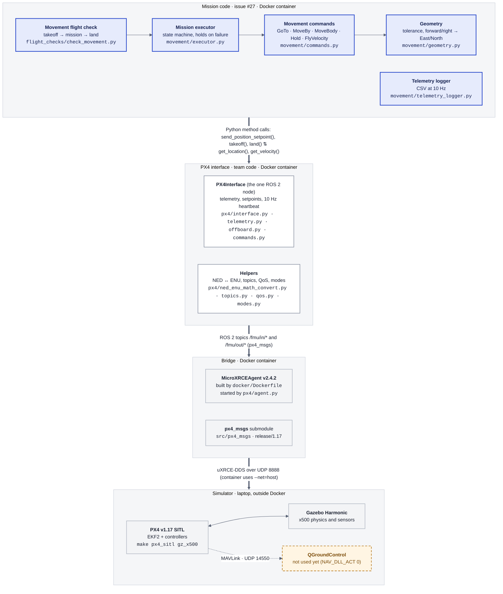
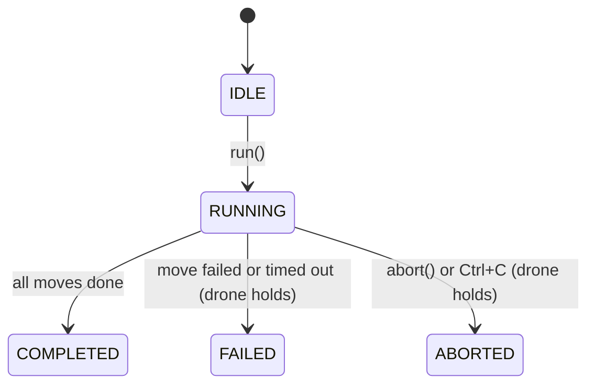

# Movement architecture (issue #27)

How the companion-computer code reaches PX4 in simulation, which file does what, and what issue #27 (basic drone movement) added. Verified in SITL on 2026-10-31: all 12 mission steps passed, 25 unit tests pass without ROS.

Colours: **blue** = new for #27 · **white** = existing team code · **grey** = third-party · **orange dashed** = not used yet.

## System layers

Read top to bottom: mission code at the top, the simulator at the bottom. Arrows are labelled with how each layer talks to the next.

## Files

| File | What it does | Status |
|---|---|---|
| `src/drone/drone/flight_checks/check_movement.py` | The script you run: arm, take off, 12-step mission, land, save CSV | new |
| `src/drone/drone/movement/executor.py` | Runs moves in order (IDLE → RUNNING → COMPLETED / FAILED / ABORTED); holds position on failure | new |
| `src/drone/drone/movement/commands.py` | One class per move, plus shortcuts `east(5)`, `forward(2)`, … | new |
| `src/drone/drone/movement/geometry.py` | Distances, arrival tolerance, body → ENU rotation | new |
| `src/drone/drone/movement/telemetry_logger.py` | Background thread writing position, velocity, tilt, mode, GPS, battery to CSV | new |
| `src/drone/test/test_movement.py` | 25 unit tests with a fake drone; runs in CI | new |
| `tools/plot_flight_log.py` | CSV → path plot, timeline, per-step table | new |
| `src/drone/setup.py` | Registers `check_movement` | changed |
| `.dockerignore`, `.gitignore` | Keep build output out of Docker; ignore `flight_logs/` | new / changed |
| `src/drone/drone/px4/` | PX4Interface node and helpers | team |
| `src/drone/drone/flight_checks/common.py` | Connect, arm, enter offboard (reused by `check_movement`) | team |
| `docker/Dockerfile` | ROS 2 Humble + XRCE agent image | team |

Run it: start `make px4_sitl gz_x500` on the laptop, then in the container `ros2 run drone check_movement --sitl --api`.

## One move, step by step: `east(5)`

1. **The executor picks the next move** and tags the CSV rows with "east 5.0 m". (`executor.py`, `MissionExecutor.run()`)
2. **The move works out its target**: start = the previous move's target (or the current position for the first move), target = start + 5 m East. Rejected if below 1 m or above the height ceiling. (`commands.py`, `PositionCommand.start()`)
3. **The target is sent once**; the node's heartbeat repeats it 10 times a second. (`px4/offboard.py`, `send_position_setpoint()` → `/fmu/in/trajectory_setpoint`)
4. **PX4 flies there.** Its controllers decide tilt and motor speeds; our code never touches the motors.
5. **Every 0.2 s the executor checks "arrived?"**: within tolerance (0.3 m here) and slower than 0.5 m/s; failed after 30 s. (`PositionCommand.update()`, `geometry.reached()`)
6. **The next move starts from this target**, not from where the drone stopped, so errors don't add up.

## Known limitations (from the SITL log)

- `up 2.0 m` finished 0.28 m short: the arrival rule (0.3 m floor, 0.5 m/s) is loose for short vertical moves.
- `FlyVelocity` reports done before the drone brakes; it coasted 0.45 m.
- 5 m legs reached 3.6 m/s and about 32° tilt with PX4's default limits. Agree on limits in QGroundControl before real flights.
