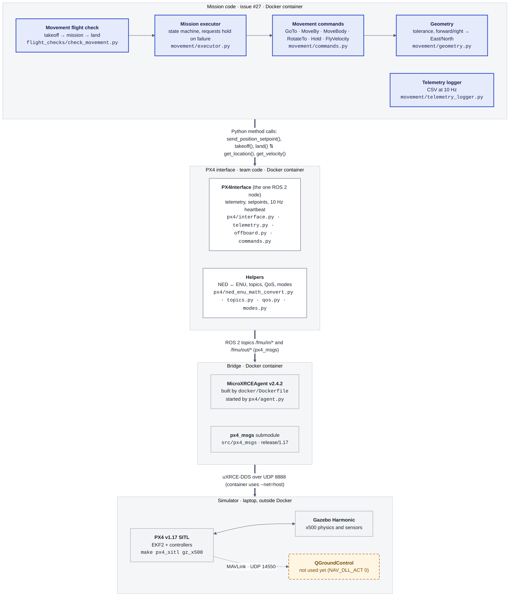
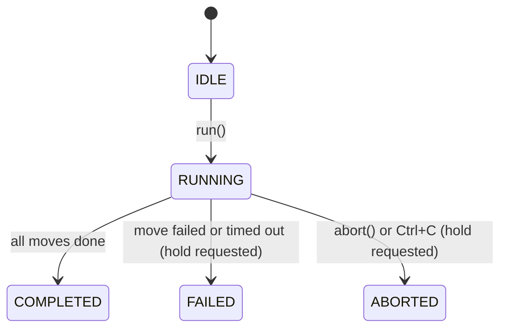

# Movement architecture (issue #27)

How to set up and run the movement check, how the companion-computer code reaches PX4, and what issue #27 added. The original 12-step mission passed SITL on 2026-10-31. Recovery and yaw support were added afterward; validation limits are recorded below.

Colours: **blue** = new for #27 · **white** = existing team code · **grey** = third-party · **orange dashed** = not used yet.

## System layers

Read top to bottom: mission code at the top, the simulator at the bottom. Arrows are labelled with how each layer talks to the next.



## Files

| File | What it does | Status |
|---|---|---|
| `src/drone/drone/flight_checks/check_movement.py` | The script you run: arm, take off, 15-step mission, land, save CSV | new |
| `src/drone/drone/movement/executor.py` | Runs moves in order (IDLE → RUNNING → COMPLETED / FAILED / ABORTED); requests hold on failure | new |
| `src/drone/drone/movement/commands.py` | One class per move, plus shortcuts `east(5)`, `forward(2)`, … | new |
| `src/drone/drone/movement/geometry.py` | Distances, arrival tolerance, body → ENU rotation | new |
| `src/drone/drone/movement/telemetry_logger.py` | Background thread writing position, velocity, tilt, mode, GPS, battery to CSV | new |
| `src/drone/test/test_movement.py` | 25 unit tests with a fake drone; runs in CI | new |
| `src/drone/test/test_movement_recovery.py`, `test_movement_yaw.py` | Recovery and heading tests without ROS | new |
| `src/drone/setup.py` | Registers `check_movement` | changed |
| `.dockerignore`, `.gitignore` | Keep build output out of Docker; ignore `flight_logs/` | new / changed |
| `src/drone/drone/px4/` | PX4Interface node and helpers | team |
| `src/drone/drone/flight_checks/common.py` | Connect, arm, enter offboard (reused by `check_movement`) | team |
| `docker/Dockerfile` | ROS 2 Humble + XRCE agent image | team |

## Setup and run in SITL

These instructions use the team's Linux setup: PX4 SITL and Gazebo run on the
laptop; ROS 2 Humble and MicroXRCEAgent run in Docker. For first-time installation
of PX4/Gazebo and the version stack, follow [Ubuntu 24.04 setup](dev_setup_ubuntu24.md).
The examples assume the two repositories are siblings under
`~/drone/mcgill-robotics`; adjust the host paths if yours differ.

| Terminal | Where it runs | Purpose |
|---|---|---|
| A | Laptop / host | PX4 SITL and Gazebo |
| B | Docker shell | Build ROS packages and run the flight check |
| C (optional) | Second shell in the same container | Observe ROS telemetry |

### 1. Prepare the workspace and Docker image (host)

```bash
cd ~/drone/mcgill-robotics/drone-SW-26-27
git submodule update --init --recursive
docker build -f docker/Dockerfile -t drone-2027 .
```

The image contains ROS 2 and the XRCE agent. Build it initially and when its
Dockerfile changes; ordinary Python edits only require rebuilding the ROS
workspace when necessary, not rebuilding the image.

### 2. Start the simulator (host terminal A)

```bash
cd ~/drone/mcgill-robotics/PX4-Autopilot
make px4_sitl gz_x500
```

Keep this terminal running. Wait for the vehicle and world to load in Gazebo.
Start with the vehicle on the ground; restart SITL between independent recovery
experiments if the previous run left its state uncertain.

### 3. Open the ROS container (host terminal B)

```bash
cd ~/drone/mcgill-robotics/drone-SW-26-27
docker run -it --rm --net=host --name drone-movement \
  -v "$PWD":/home/devuser/drone-2027 \
  drone-2027
```

Run this from **drone-SW-26-27**, not PX4-Autopilot. `$PWD` is the directory mounted
into Docker. `--net=host` lets the agent reach SITL over UDP 8888. `drone-2027` is
the image name; `drone-movement` is the container name chosen for these examples.
Only one container with that name can exist at a time (`docker ps -a` lists them).

The container opens a Bash shell. Source code and `flight_logs/`, `build/`,
`install/`, and `log/` live in the mounted workspace and persist after exit.
`--rm` removes the container itself on exit; rerun the command to create it again.

### 4. Build and source the workspace (inside Docker)

```bash
cd /home/devuser/drone-2027
source /opt/ros/humble/setup.bash
colcon list
colcon build --packages-up-to drone --symlink-install
source install/setup.bash
```

`colcon list` should include both `drone` and `px4_msgs`. `--packages-up-to drone`
builds the selected package and its workspace dependencies. On an already-built
workspace, `--packages-select drone` is sufficient when only the drone package
needs rebuilding. Source `install/setup.bash` in each new shell before running
package commands. Run each build successfully before sourcing its result.

### 5. Check the connection, then run the mission (inside Docker)

```bash
ros2 run drone check_link --sitl
ros2 run drone check_movement --sitl --api
```

Wait for `check_link` to finish before starting the movement check. Each check
starts its own agent and cleans it up afterward. Do not run two flight checks
simultaneously. If you deliberately manage an agent separately, use `--no-agent`;
otherwise let the check start it.

`--api` permits code-based arming only with `--sitl`. Omitting it makes the check
wait for pilot arming. These instructions demonstrate simulation; real-aircraft
setup and pilot arming are covered in [arming](arming.md) and
[PX4 setup](px4_setup.md).

The default check enters OFFBOARD, arms, requests a 3 m climb, executes the 15-step mission,
then requests LAND and waits for landing detection. The mission consists of:

1. A 5 m square: East, North, West, South.
2. Up 2 m, then down 2 m.
3. Rotate to face North, then forward, back, right, left, each 2.5 m relative to the nose.
4. Rotate to face East, then Eastward velocity of 1 m/s for 3 seconds.
5. Hold for 2 seconds.
6. `GoTo` the measured post-takeoff start position while facing East.

Coordinates are ENU: X East, Y North, Z Up. Position targets are relative to PX4's
local origin, not GPS altitude. `--altitude` currently requests a climb from the
measured starting height, despite the CLI describing it as takeoff height.
Takeoff can finish within its 0.3 m / 5% tolerance; the first movement starts from
the measured position at that time.

### Options and results

```bash
ros2 run drone check_movement --help
ros2 run drone check_movement --sitl --api \
  --altitude 5 --side 8 --log-rate 10 --log-dir flight_logs
```

| Option | Default | Meaning |
|---|---|---|
| `--sitl` | Off | Select the SITL link configuration |
| `--api` | Off | Arm from code; requires `--sitl` |
| `--altitude` | `3.0` | Requested takeoff climb in metres |
| `--side` | `5.0` | Square side in metres; body legs use half this distance |
| `--log-rate` | `10.0` | CSV samples per second; use a positive value |
| `--log-dir` | `flight_logs` | Output directory relative to the working directory |

Each move prints its label and duration. A normal successful ending includes:

```text
[MISSION] running -> completed
[PX4] Landing complete, vehicle reports landed
[MAIN] ✓ Check passed
```

Mission completion alone does not mean landing succeeded. Exit code 0 means the
check succeeded; 1 means failure/interruption; 2 indicates rejected arming options
(or an argument-parser error). To see the exit code, run `echo $?` immediately
after the check.

CSV filenames look like `flight_logs/movement_20261107_172510.csv`. Rows contain
elapsed seconds, step label, mode, armed/landed flags, ENU position and velocity,
speed, roll/pitch/yaw in degrees, GPS and battery fields. Recovery landing rows
use the label `land`. The mounted directory makes these files available in the
host editor too. No plotting script is currently included in this repository.

### Run a custom sequence with yaw

The default mission includes North/East rotations and an absolute return leg.
To try a shorter custom yaw sequence without editing the source, run this inside
Docker after sourcing the workspace:

```bash
python3 - --sitl --api <<'PY'
import math
from drone.flight_checks import check_movement
from drone.movement.commands import GoTo, Hold, RotateTo, east, west


def yaw_mission(side, start):
    return [
        RotateTo(math.pi / 2),  # Face North while holding position.
        Hold(2),
        east(3),               # Translate East while still facing North.
        RotateTo(0),           # Face East.
        Hold(2),
        west(3),               # Translate West while facing East.
    ]


# Replace the mission for this process only; retain normal takeoff and recovery.
check_movement.build_mission = yaw_mission
raise SystemExit(check_movement.main())
PY
```

For simultaneous translation and heading change, use a position command such as
`GoTo(5, 2, 3, yaw=math.pi / 2)`. Yaw is in radians; see
[Camera heading commands](#camera-heading-commands) for persistence and limitations.
The example holds do not trigger the camera.

### Test recovery

Run automated tests from the repository root, either on a host with pytest or
inside the container:

```bash
pytest -q
pytest -v src/drone/test/test_movement_recovery.py
pytest -v src/drone/test/test_movement_yaw.py
```

As checked on 2026-11-07, the full suite has 103 passing tests: 25 original
movement tests, 17 recovery tests, 13 yaw/mission tests, and 48 other PX4 tests.
The expanded 15-step mission still needs SITL verification; the historical
12-step SITL result does not verify the new sequence.

These tests need no ROS connection. They cover command exceptions, failed takeoff,
interruption, hold/LAND failures, and yaw completion logic using fake PX4 methods.

In SITL, first verify a normal mission. Then run it again and press Ctrl+C once
during a movement. Observe the output, Gazebo touchdown, and the CSV. The intended
flow is ABORTED, recovery hold, LAND, and cleanup, with an unsuccessful exit code
even if recovery lands successfully. However, ROS signal handling has also been
observed to stop callbacks with `ExternalShutdownException`; interruption recovery
is not yet verified reliable. A second Ctrl+C can interrupt recovery itself.

To exercise a rejected movement using the current implementation:

```bash
ros2 run drone check_movement --sitl --api --altitude 0.5
```

This is a deliberate SITL failure test: the first horizontal target inherits a
measured height below the movement minimum of 1 m and is rejected, then recovery
attempts LAND. The reported target may be much lower than 0.5 m because takeoff
uses a 0.3 m tolerance. `--altitude 1.5` is **not** a rejection test: the later
up/down pair returns to the same allowed altitude.

### Observe topics and troubleshoot

For a second ROS shell, run on the host while terminal B's container is running:

```bash
docker exec -it drone-movement bash
```

Then inside that shell:

```bash
cd /home/devuser/drone-2027
source /opt/ros/humble/setup.bash
source install/setup.bash
ros2 topic echo /fmu/out/vehicle_land_detected
```

Run the observation while a check's agent is active. Other useful commands are
`ros2 topic list` and `ros2 topic hz /fmu/out/vehicle_local_position_v1`. Actual
version suffixes depend on the checked-out message definitions.

| Symptom | What to check |
|---|---|
| `ignoring unknown package 'drone'` | Wrong mounted directory: exit and launch Docker from drone-SW-26-27; check `colcon list` |
| `ros2: command not found` | Use the ROS container and source `/opt/ros/humble/setup.bash` |
| Package/entry point or `RotateTo` missing | Rebuild the correct mounted workspace, then source `install/setup.bash` |
| Connection timeout | SITL running, `--net=host`, UDP 8888 available, compatible PX4/px4_msgs versions |
| Agent port already occupied | Check for another active check/agent; avoid starting a second agent on UDP 8888 |
| LAND accepted but landing times out | Inspect continuing landing-detector messages and Gazebo; acceptance is not touchdown confirmation |

Landing delays have been observed even at near-ground height. Inspect
`ground_contact`, `maybe_landed`, `landed`, `has_low_throttle`, and `in_descend`.
Continuing offboard setpoints during AUTO.LAND are a suspected interference source;
the proposed stop-after-confirmed-LAND handover is not implemented yet. Do not
interpret near-zero local height alone as confirmed landing, or assume a timeout
means the vehicle is disarmed.


## One move, step by step: `east(5)`

1. **The executor picks the next move** and tags the CSV rows with "east 5.0 m". (`executor.py`, `MissionExecutor.run()`)
2. **The move works out its target**: start = the previous move's target (or the current position for the first move), target = start + 5 m East. Rejected if below 1 m or above the height ceiling. (`commands.py`, `PositionCommand.start()`)
3. **The target is sent once**; the node's heartbeat repeats it 10 times a second. (`px4/offboard.py`, `send_position_setpoint()` → `/fmu/in/trajectory_setpoint`)
4. **PX4 flies there.** Its controllers decide tilt and motor speeds; our code never touches the motors.
5. **Every 0.2 s the executor checks "arrived?"**: within tolerance (0.3 m here) and slower than 0.5 m/s; failed after 30 s. (`PositionCommand.update()`, `geometry.reached()`)
6. **The next move starts from this target**, not from where the drone stopped, so errors don't add up.



## Known limitations (from the SITL log)

- `up 2.0 m` finished 0.28 m short: the arrival rule (0.3 m floor, 0.5 m/s) is loose for short vertical moves.
- `FlyVelocity` reports done before the drone brakes; it coasted 0.45 m.
- 5 m legs reached 3.6 m/s and about 32° tilt with PX4's default limits. Agree on limits in QGroundControl before real flights.

## Failure recovery

The executor records command exceptions as failed results, skips remaining moves,
and attempts position hold. Ctrl+C marks the mission aborted and propagates to
its caller. Hold errors are reported without hiding the original failure.

`check_movement` attempts hold followed by PX4 LAND after any takeoff attempt,
including a failed or interrupted takeoff. Before takeoff, it also attempts
recovery if the vehicle reports armed and not landed. A confirmed ground setup
failure skips landing. Logging and the connection remain available during recovery;
offboard streaming is stopped afterward and `run_main` closes the connection.

A failed hold does not prevent LAND. LAND rejection, timeout, exception or loss of
connection makes recovery unsuccessful. Landing success requires PX4 landing
detection rather than a height near the local origin. During link loss, recovery
cannot be confirmed by this script; the vehicle's configured PX4 failsafe governs
its behaviour. Telemetry freshness is still a separate known limitation.

Recovery tests run without ROS. Repeat SITL interruption and failure checks before
considering this recovery behaviour flight-verified.

## Camera heading commands

Position commands accept `yaw` and `yaw_tolerance` in radians, using ENU headings
(East = 0, North = pi/2). `RotateTo` holds the last position target, or the current
position for the first command, while turning to an absolute heading:

```python
import math
from drone.movement.commands import GoTo, Hold, RotateTo, east

mission = [
    RotateTo(math.pi / 2),        # Face North.
    Hold(2),                     # Keep the heading before collecting an image.
    east(5),                     # Move East while still facing North.
    GoTo(0, 0, 3, yaw=0),         # Fly to local-origin X/Y at Z=3, facing East.
]
```

Explicit yaw persists across position commands and holds until replaced. Commands
without any explicit mission yaw keep the existing PX4Interface heading behaviour.
Arrival requires position tolerance, low translational speed, and heading within
`yaw_tolerance` (default 5 degrees). Heading error wraps across +/-pi. Rotation
commands use the existing position altitude limits and timeout handling.

This does not check angular speed or provide a camera trigger/gimbal controller.
The existing yaw getter can fall back to zero when telemetry is unavailable;
telemetry freshness and angular settling still need separate work. During a
`FlyVelocity` leg the existing yaw-rate behaviour remains unchanged; the explicit
mission heading is restored when the command switches back to position hold.
Yaw behaviour has unit tests but still needs SITL verification.
