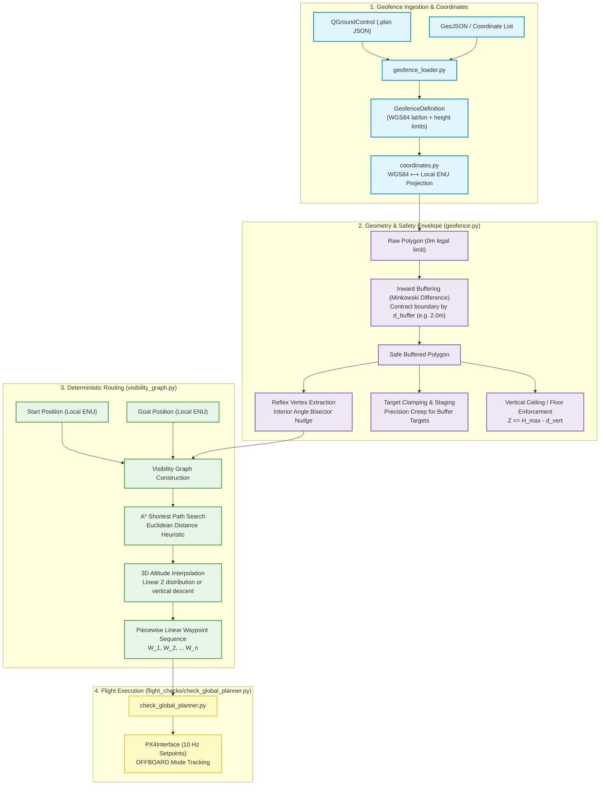

# Global Planning Layer: Geofence & Concave Avoidance

Comprehensive technical documentation for the **Global Planning Layer** in `drone-2027`.

This layer provides deterministic, mathematically guaranteed navigation around complex **concave geofences**, enforces horizontal and vertical safety buffers, resolves edge cases like targets within buffer zones, and loads mission parameters directly from QGroundControl.

---

## 1. System Overview & The Concave Geofence Problem

In autonomous drone operations, geofences define the legal airspace perimeter (keep-in zone). Autopilot firmware (PX4) enforces hard failsafes at this boundary, but has limited lookahead. 

### Why Concave Boundaries Require Global Planning

```
      CONVEX GEOFENCE                        CONCAVE GEOFENCE
      +--------------+                       +--------\          /--------+
      |              |                       |         \        /         |
      |   A ------> B|                       |   A -----\- - - /-----> B  |
      |              |                       |           \    /  (BREACH!)|
      +--------------+                       +------------\  /------------+
   Path always remains                                     \/
 strictly inside boundary.                  Direct straight-line cuts through 
                                               forbidden exterior airspace!
```

* **Convex Geofences:** Any straight line connecting two interior points is guaranteed to stay within the boundary.
* **Concave Geofences:** A straight-line trajectory between two valid points inside the geofence can leave the safe area and cut across a forbidden indentation (e.g. tree lines, buildings, or spectator zones).
* **Local Minima:** Reactive local avoidance (like artificial potential fields) can get trapped in inward-facing "pockets" where opposing repulsive forces balance forward momentum.

The Global Planning Layer solves this by computing a **deterministic Visibility Graph over reflex vertices**, guaranteeing the shortest safe route around all concave indentations.

---

## 2. Architecture & Data Flow



---

## 3. Module Breakdown

All planning modules reside under [`src/drone/drone/planning/`](../../src/drone/drone/planning/):

```text
src/drone/drone/planning/
├── __init__.py           # Package exports
├── coordinates.py        # WGS84 GPS <-> Local ENU metric conversions (pure math)
├── geofence_loader.py    # Universal loader (QGC .plan, GeoJSON, coordinate lists)
├── geofence.py           # Inward buffering, reflex vertices, target clamping & staging
└── visibility_graph.py   # Visibility graph generation & A* shortest-path search
```

### 1. `coordinates.py`
Provides conversions between WGS84 ellipsoidal coordinates $(\text{Lat}, \text{Lon}, \text{Alt})$ and Local ENU $(x, y, z)$ in metres, anchored to the drone's takeoff GPS datum:

* **Forward (`wgs84_to_enu`):**
  $$\Delta \text{North} = (\text{lat} - \text{lat}_0) \cdot \frac{\pi}{180} \cdot R_E$$
  $$\Delta \text{East} = (\text{lon} - \text{lon}_0) \cdot \frac{\pi}{180} \cdot R_E \cdot \cos(\text{lat}_0)$$
  $$\Delta \text{Up} = \text{alt} - \text{alt}_0$$
* **Inverse (`enu_to_wgs84`):** Converts local metric positions back to GPS decimal degrees.
* Aligned with `common.py:gps_to_local_offset`, accurate to millimetres across flight fields. Zero external dependencies.

---

### 2. `geofence_loader.py`
Universal loader returning a standardized `GeofenceDefinition`:
* **QGroundControl `.plan` Files:** Directly parses the JSON format exported by QGC:
  * Reads boundary vertices from `geoFence.polygons[0].polygon`.
  * Extracts altitude limits from `geoFence.maxAltitude` and `geoFence.minAltitude`.
* **GeoJSON:** Parses RFC 7946 Polygon geometry, converting standard GeoJSON `[lon, lat]` into `(lat, lon)` and stripping closing vertex duplicates.
* **Direct Lists:** Accepts raw lists of `[(lat, lon), ...]`.

---

### 3. `geofence.py`
Manages the metric geometry and safety boundaries via `shapely`:

* **Inward Safety Buffering:**  
  Contracts the boundary inward by $d_{\text{buffer}}$ (default $2.0\text{ m}$) using `join_style="mitre"`:
  ```python
  safe_polygon = raw_polygon.buffer(-buffer_m, join_style="mitre", mitre_limit=3.0)
  ```
* **Reflex Vertex Extraction:**  
  Identifies inward-pointing corners ($> 180^\circ$ interior angle) where the 2D cross product of adjacent edges is negative:
  $$\mathbf{v}_1 \times \mathbf{v}_2 = (x_{\text{curr}} - x_{\text{prev}})(y_{\text{next}} - y_{\text{curr}}) - (y_{\text{curr}} - y_{\text{prev}})(x_{\text{next}} - x_{\text{curr}}) < 0$$
* **Interior Angle Bisector Nudge:**  
  To prevent the drone from skimming the buffer line during high-speed turns, reflex vertices are nudged slightly into the safe polygon along the exact interior angle bisector:
  $$\mathbf{u}_{\text{bisector}} = \frac{\mathbf{u}_1 + \mathbf{u}_2}{\|\mathbf{u}_1 + \mathbf{u}_2\|}$$
* **Vertical Safety Limits:**  
  Enforces altitude boundaries with a vertical safety buffer ($d_{\text{vert}} = 1.0\text{ m}$):
  $$H_{\min} + d_{\text{vert}} \le Z \le H_{\max} - d_{\text{vert}}$$

---

### 4. `visibility_graph.py`
Computes the mathematically shortest collision-free path:

1. **Direct Visibility Check:** First tests if the straight line between Start and Goal lies strictly inside the safe polygon. If clear, returns a direct 2-point path.
2. **Graph Construction:** If blocked by a concave cutout:
   * Nodes = $\{\text{Start}\} \cup \{\text{Goal}\} \cup \{\text{Nudged Reflex Vertices}\}$.
   * Checks line-of-sight between all node pairs. A line is valid if `safe_polygon.buffer(0.005).contains(line)` and it does not intersect exterior boundaries.
   * Edge weights = Euclidean distance: $d(u, v) = \sqrt{\Delta x^2 + \Delta y^2}$.
3. **$A^*$ Search:** Computes the optimal node sequence from Start to Goal using Euclidean distance heuristic.
4. **Altitude Distribution:** Distributes $Z$ continuously along the cumulative 2D path length:
   $$Z_i = Z_{\text{start}} + \frac{L_i}{L_{\text{total}}} (Z_{\text{goal}} - Z_{\text{start}})$$

---

## 4. Edge Cases Handled

### 1. Target Inside Buffer Zone (The 1-Meter Problem)

```
RAW GEOFENCE BOUNDARY (Hard Limit: 0m)
========================================================================
             ^
             | 1.0m (Margin)
             v
         [TARGET POINT]  <--- Reached in Stage 2 at crawl speed (0.3 m/s)
             ^
             | 1.0m (Margin)
             v
- - - - - - - - - - - - - - - - - - - - - - - - - - - - - - - - - - - - 
SAFE BUFFER BOUNDARY (2.0m from wall)
             ^
     [STAGING POINT]     <--- Reached in Stage 1 at normal cruise speed (5 m/s)
```

* **Scenario:** A mission waypoint is placed $1.0\text{ m}$ from the fence (inside the $2.0\text{ m}$ buffer margin).
* **Handling (`create_staging_target`):**
  * **Stage 1 (Cruise):** Global planner creates a **Staging Point** projected orthogonally onto the safe $2\text{ m}$ boundary. The drone cruises there at normal speed.
  * **Stage 2 (Precision Creep):** Once arrived and stabilized, the drone enters creep mode ($v \le 0.3\text{ m/s}$) to reach the final $1\text{ m}$ target. At $0.3\text{ m/s}$, stopping distance is under $5\text{ cm}$, preventing boundary overshoot.

### 2. Vertical Descent Missions (Going Straight Down)
* **Scenario:** Drone is commanded to descend straight down from $15\text{ m}$ to $2\text{ m}$ (e.g. payload drop or low inspection).
* **Handling:** Geofences are vertical 2.5D prisms. Because $(X, Y)$ coordinates remain constant, if the drone was horizontally safe at $15\text{ m}$, it is guaranteed horizontally safe at $2\text{ m}$. The planner verifies $Z \ge H_{\min} + d_{\text{vert}}$ and returns a clean 2-point vertical trajectory.

### 3. Out-of-Bounds Targets
* Targets placed completely outside the legal geofence ($< 0\text{ m}$) are automatically clamped to the nearest safe interior point.

---

## 5. Usage & Code Examples

### Basic Python Usage

```python
from drone.planning import (
    load_geofence,
    BufferedGeofence,
    VisibilityGraphPlanner,
)

# 1. Load geofence from a QGroundControl plan file
fence_def = load_geofence("competition_field.plan")

# 2. Project around drone takeoff GPS coordinates (Lat, Lon, Alt)
geofence = BufferedGeofence.from_wgs84(
    definition=fence_def,
    origin_lat=47.397742,
    origin_lon=8.545594,
    origin_alt=488.0,
    buffer_m=2.0,       # 2m horizontal buffer
    vert_buffer_m=1.0,  # 1m vertical buffer
)

# 3. Plan path around concave boundary
planner = VisibilityGraphPlanner(geofence)
start_enu = (-15.0, 25.0, 10.0)  # (East, North, Up) in metres
goal_enu  = ( 15.0, 25.0, 10.0)

waypoints = planner.plan_path(start_enu, goal_enu)

for i, wp in enumerate(waypoints):
    print(f"Waypoint {i + 1}: East={wp[0]:.2f}m, North={wp[1]:.2f}m, Up={wp[2]:.2f}m")
```

---

## 6. Testing & Verification

### 1. Automated Pure Unit Tests (Fast, No ROS required)
The test suite [`src/drone/test/test_planning_pure.py`](../../src/drone/test/test_planning_pure.py) contains 12 unit tests covering all geometric calculations, QGC loading, buffering, clamping, concave routing, and vertical descent:

```bash
pytest src/drone/test/test_planning_pure.py -v
```

### 2. Running in SITL Simulation
A standalone flight check script is provided in [`src/drone/drone/flight_checks/check_global_planner.py`](../../src/drone/drone/flight_checks/check_global_planner.py):

1. **Launch PX4 SITL and Gazebo:**
   ```bash
   make px4_sitl gz_x500
   ```
2. **Run the Flight Check in the Docker container:**
   ```bash
   ros2 run drone check_global_planner --sitl --api --alt 10 --buffer 2.0
   ```
   * Or test with a custom QGC plan file:
   ```bash
   ros2 run drone check_global_planner --sitl --api --fence /path/to/my_field.plan
   ```
3. The drone arms in OFFBOARD mode, climbs to $10\text{ m}$, navigates sequentially around the concave cutout via the computed waypoints, holds position, and lands safely.

